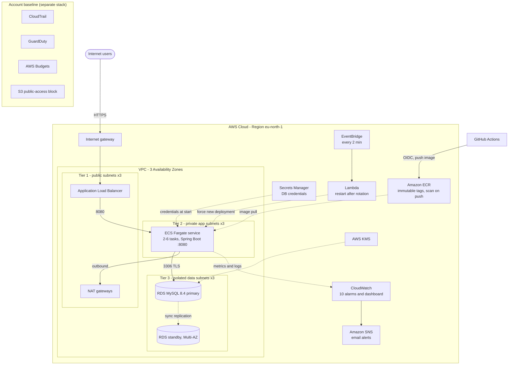
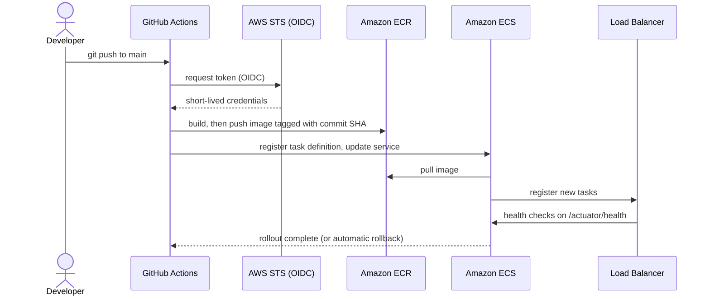

<div align="center">

# 3-Tier Infrastructure on AWS

**Production-style three-tier platform built entirely with Terraform:**
ALB, ECS Fargate, RDS MySQL, GitHub Actions CI/CD with OIDC, monitoring, and an account security baseline.

[](https://github.com/Chathuka-2003/3-tier-infrastructure/actions/workflows/deploy.yml)
[](https://github.com/Chathuka-2003/3-tier-infrastructure/actions/workflows/terraform-ci.yml)


</div>

---

## Table of contents

1. [Overview](#overview)
2. [Architecture](#architecture)
3. [Key features](#key-features)
4. [Tech stack](#tech-stack)
5. [Repository structure](#repository-structure)
6. [Environments](#environments)
7. [Getting started](#getting-started)
8. [CI/CD pipeline](#cicd-pipeline)
9. [Monitoring and alerting](#monitoring-and-alerting)
10. [Security](#security)
11. [Secret rotation: a problem found and fixed](#secret-rotation-a-problem-found-and-fixed)
12. [Cost](#cost)
13. [Testing and operations](#testing-and-operations)
14. [Troubleshooting](#troubleshooting)
15. [Roadmap and known limitations](#roadmap-and-known-limitations)
16. [Documentation index](#documentation-index)
17. [Author](#author)

---

## Overview

This repository provisions a complete, repeatable three-tier web platform on AWS and ships a small
Spring Boot application onto it to prove that every tier works end to end.

What it demonstrates:

- **Infrastructure as Code:** reusable Terraform modules, one remote state per environment, S3 native locking.
- **High availability design:** 3 Availability Zones, Multi-AZ database, NAT gateway per AZ (prod), autoscaling.
- **Secure by default:** private and isolated subnets, security-group chaining, encrypted data, no secrets in code or state, no stored cloud keys in CI.
- **Delivery automation:** build, push, and a rolling deployment with automatic rollback.
- **Operability:** alarms, dashboard, runbook, acceptance tests, and a self-healing fix for a real failure mode found during testing.

> The application is a deliberately small "notes" API. The infrastructure is the point of this project.

---

## Architecture



<!-- Optional: add an exported diagram or animation here, for example:
 -->

### The three tiers

| Tier | Component | Placement | Notes |
|---|---|---|---|
| 1. Presentation | Application Load Balancer | Public subnets | Only entry point; health checks on `/actuator/health`; HTTPS-ready |
| 2. Application | ECS Fargate service | Private app subnets | Autoscaling 2 to 6 tasks (prod), rolling deploys, circuit-breaker rollback |
| 3. Data | RDS MySQL 8.4 | Isolated data subnets | No route to the internet; encrypted; Multi-AZ in prod |

### Traffic and security-group chain

```
Internet -> ALB SG (80/443) -> App SG (8080, from ALB only) -> DB SG (3306, from app only)
```

Network layout (prod): VPC `10.1.0.0/16`, public `10.1.0.0/24` to `10.1.2.0/24`, private app `10.1.10.0/24` to `10.1.12.0/24`, isolated data `10.1.20.0/24` to `10.1.22.0/24`.
Dev uses `10.0.0.0/16` with the same numbering.

---

## Key features

**Infrastructure**
- Modular Terraform: `network`, `rds`, `ecr`, `alb`, `ecs`, `monitoring`, `github-oidc`, `rotation-restart`.
- Separate state per environment (`dev`, `prod`, `account-baseline`) in a versioned, encrypted S3 bucket with native locking.
- VPC flow logs, locked-down default security group, private VPC endpoints for ECR, CloudWatch Logs, Secrets Manager, and S3 (prod).

**Application platform**
- ECS Fargate with CPU and request-count autoscaling.
- Rolling deployments (100% minimum healthy, 200% maximum) with the deployment circuit breaker and automatic rollback.
- Immutable ECR tags (commit SHA), scan on push, lifecycle policy.

**Data**
- RDS MySQL 8.4, customer-managed KMS key, TLS required, slow-query and error logs exported, 14-day backups and deletion protection in prod.
- The database password is generated and rotated by RDS in Secrets Manager and injected into containers at start.

**Delivery and operations**
- GitHub Actions authenticates to AWS with OIDC (no stored keys); the role is limited to one ECR repository and one ECS service.
- 10 CloudWatch alarms, a dashboard, and SNS email alerts.
- A Lambda that restarts tasks after each secret rotation (see [below](#secret-rotation-a-problem-found-and-fixed)).
- Account baseline: CloudTrail, GuardDuty, monthly budget alerts, S3 public-access block.

---

## Tech stack

| Area | Tools |
|---|---|
| Cloud | AWS: VPC, ALB, ECS Fargate, ECR, RDS, KMS, Secrets Manager, CloudWatch, SNS, EventBridge, Lambda, CloudTrail, GuardDuty, Budgets |
| IaC | Terraform (AWS provider 5.x, archive provider for the Lambda package) |
| CI/CD | GitHub Actions, OIDC federation, Docker |
| Application | Java 21, Spring Boot 3, Spring Data JPA, Actuator, MySQL Connector/J |
| Database | Amazon RDS for MySQL 8.4 |

---

## Repository structure

```
.
├── app/                        # Spring Boot notes API (used to prove all three tiers)
│   ├── Dockerfile              # Multi-stage build, non-root user
│   └── src/
├── infra/
│   ├── modules/
│   │   ├── network/            # VPC, subnets, NAT, endpoints, flow logs
│   │   ├── rds/                # MySQL, KMS, managed secret, parameter group
│   │   ├── ecr/                # Registry, lifecycle policy
│   │   ├── alb/                # Load balancer, target group, listeners
│   │   ├── ecs/                # Cluster, task definition, service, autoscaling, IAM
│   │   ├── monitoring/         # SNS, alarms, dashboard
│   │   ├── github-oidc/        # Deploy role trusted by GitHub Actions
│   │   └── rotation-restart/   # Lambda that restarts ECS after secret rotation
│   ├── envs/
│   │   ├── dev/                # Cost-trimmed environment
│   │   └── prod/               # Production defaults (+ practice.tfvars for cheap rehearsal)
│   └── account-baseline/       # CloudTrail, GuardDuty, budget, S3 public-access block
├── .github/workflows/
│   ├── deploy.yml              # build-and-deploy
│   └── terraform-ci.yml        # fmt + validate for every stack
└── docs/                       # Architecture, runbook, acceptance tests, cost, access
```

---

## Environments

| Setting | dev | prod |
|---|---|---|
| VPC CIDR | `10.0.0.0/16` | `10.1.0.0/16` |
| NAT gateways | 1 | 3 (one per AZ) |
| Interface VPC endpoints | off | on (4) |
| Database | `db.t4g.micro`, single-AZ, 1-day backups | `db.t4g.medium`, Multi-AZ, 14-day backups, deletion protection |
| ECS tasks | 1 (max 2) | 2 minimum (max 6) |
| Container Insights | off | on |

> **Status:** `dev` has been deployed and tested end to end. `prod` is fully defined and
> `terraform plan` succeeds (93 resources), but it has not been applied in the author's account.
> `infra/envs/prod/practice.tfvars` applies dev-like settings to the prod code for cheap rehearsal.

---

## Getting started

### Prerequisites

- An AWS account and an IAM user with administrator access for the initial setup (use an access key or SSO; avoid root).
- AWS CLI v2, Terraform 1.10 or newer, Docker, and Git.
- A GitHub repository (fork or clone of this one).

### 1. Create the Terraform state bucket (one time)

```bash
export AWS_REGION=eu-north-1
BUCKET="tfstate-$(aws sts get-caller-identity --query Account --output text)-$AWS_REGION"

aws s3api create-bucket --bucket "$BUCKET" --region "$AWS_REGION" \
  --create-bucket-configuration LocationConstraint="$AWS_REGION"
aws s3api put-bucket-versioning --bucket "$BUCKET" --versioning-configuration Status=Enabled
aws s3api put-public-access-block --bucket "$BUCKET" --public-access-block-configuration \
  BlockPublicAcls=true,IgnorePublicAcls=true,BlockPublicPolicy=true,RestrictPublicBuckets=true
```

### 2. Configure and deploy `dev`

```bash
cd infra/envs/dev
cp backend.hcl.example backend.hcl
sed -i "s|REPLACE-with-your-unique-state-bucket|$BUCKET|" backend.hcl

cat > terraform.tfvars <<'EOF'
alert_email = "you@example.com"
github_repo = "<owner>/<repo>"
# create_oidc_provider       = false   # set these two if the account already has a GitHub OIDC provider
# existing_oidc_provider_arn = "arn:aws:iam::<account-id>:oidc-provider/token.actions.githubusercontent.com"
EOF

terraform init -backend-config=backend.hcl
terraform plan -out tfplan
terraform apply "tfplan"
```

The first apply runs a placeholder nginx image, so you can confirm the path internet to ALB to Fargate before your own image exists:

```bash
curl -i http://$(terraform output -raw alb_dns_name)
```

### 3. Deploy the real application

```bash
ECR=$(terraform output -raw ecr_repository_url)
aws ecr get-login-password | docker login --username AWS --password-stdin "${ECR%%/*}"

cd ../../../app
docker build --platform linux/amd64 -t "$ECR:v1" .
docker push "$ECR:v1"

cd ../infra/envs/dev
cat >> terraform.tfvars <<EOF
container_image   = "$ECR:v1"
container_port    = 8080
health_check_path = "/actuator/health"
EOF
terraform apply
```

### 4. Verify all three tiers

```bash
ALB=$(terraform output -raw alb_dns_name)
curl -s http://$ALB/actuator/health                      # {"status":"UP"}  (includes the database check)
curl -s -X POST http://$ALB/api/notes \
  -H 'Content-Type: application/json' -d '{"content":"hello from AWS"}'
curl -s http://$ALB/api/notes                            # the note comes back from MySQL
```

### 5. Turn on CI/CD

1. Add a repository **variable** `AWS_ROLE_ARN` with the value of `terraform output -raw github_actions_role_arn`.
2. Optionally add `ALB_URL` (for example `http://<alb-dns-name>`) to enable the post-deploy smoke test.
3. Push to `main` (or run the workflow manually). From then on, every change under `app/` deploys itself.

### 6. Account baseline (optional but recommended)

```bash
cd infra/account-baseline
cp backend.hcl.example backend.hcl            # set the bucket name
echo 'alert_email = "you@example.com"' > terraform.tfvars
# Add enable_guardduty = false if the account cannot use GuardDuty,
# and create_cloudtrail = false if a trail already exists.
terraform init -backend-config=backend.hcl && terraform plan -out tfplan && terraform apply tfplan
```

### 7. Tear down

```bash
cd infra/envs/dev && terraform destroy        # stops the hourly charges; rebuild any time with plan and apply
```

---

## CI/CD pipeline



| Workflow | Trigger | What it does |
|---|---|---|
| `build-and-deploy` | Push to `main` under `app/`, manual run; pull requests (build only) | Assumes the deploy role through OIDC, builds a `linux/amd64` image, pushes it tagged with the first 12 characters of the commit SHA, registers a new task definition, deploys, waits up to 15 minutes for stability, and runs an optional smoke test |
| `terraform-ci` | Any change under `infra/` | `terraform fmt -check` and `terraform validate` for `dev`, `prod`, and `account-baseline` (no AWS access needed) |

Design points: no AWS keys are stored in GitHub; the role trusts only `repo:<owner>/<repo>:ref:refs/heads/main`;
re-running a build for the same commit reuses the existing image because tags are immutable.

---

## Monitoring and alerting

| Alarm (`threetier-<env>-...`) | Signals |
|---|---|
| `no-healthy-targets`, `unhealthy-targets` | The site is down or a task is failing health checks |
| `app-5xx`, `slow-responses` | Application errors and latency |
| `ecs-cpu-high`, `ecs-memory-high` | Task pressure |
| `db-cpu-high`, `db-connections-high`, `db-free-storage-low`, `db-free-memory-low` | Database health |
| `...-restart-on-rotation-errors` | The self-healing Lambda itself is failing |

A CloudWatch dashboard (`threetier-<env>`) shows requests, errors, latency, healthy targets, and ECS and database metrics.
Alarms publish to an SNS topic with an email subscription (confirm the subscription once).
Test an alert: `aws cloudwatch set-alarm-state --alarm-name threetier-<env>-app-5xx --state-value ALARM --state-reason test`.

---

## Security

| Control | Implementation |
|---|---|
| Network isolation | Three subnet layers; data subnets have no internet route; tasks have no public IPs |
| Least-privilege traffic | Security-group chain; the database accepts connections only from the application tier |
| Encryption | RDS storage, Performance Insights, and the master secret use a customer-managed KMS key (rotation on); TLS required for MySQL; S3 buckets encrypted |
| Secrets | Generated by RDS in Secrets Manager and injected at container start; never in code, variables, or Terraform state |
| CI/CD identity | OIDC federation, role limited to one ECR repository and one ECS service, trust limited to the `main` branch |
| Supply chain | ECR scan on push, immutable tags, non-root container user |
| Audit and detection | CloudTrail (multi-region, log-file validation), GuardDuty with email alerts, VPC flow logs |
| Guardrails | S3 account-level public-access block, monthly AWS Budget alerts, locked-down default security group |

---

## Secret rotation: a problem found and fixed

RDS rotates its managed database password automatically (every 7 days by default), but ECS reads the
secret only when a task **starts**. Testing in `dev` showed what happens next: a task that started before a rotation kept the
old password, and once its connection pool recycled connections it logged `Access denied for user` and could not reconnect.

The fix is the `rotation-restart` module:

1. EventBridge invokes a small Lambda every 2 minutes.
2. The Lambda compares the secret's last rotation time with the start time of the current ECS deployment.
3. If the secret is newer, it forces a rolling deployment, so new tasks read the current password.
4. It skips a run while a deployment is in progress, and an alarm emails the team if the function errors.

Residual risk: for a few minutes after a rotation (the check interval plus rollout time) a task can still return errors.
A dedicated application database user that is not auto-rotated would remove that risk entirely and is on the roadmap.

---

## Cost

Rough monthly ranges for `eu-north-1` if left running 24/7. These are estimates; confirm with the
[AWS Pricing Calculator](https://calculator.aws/).

| Environment | Rough cost | Main drivers |
|---|---|---|
| dev | about 70 to 110 USD | NAT gateway, ALB, RDS, one Fargate task |
| prod defaults | about 350 to 500 USD | 3 NAT gateways, interface endpoints, Multi-AZ RDS, ALB, Fargate, CloudWatch |

Run `terraform destroy` in `dev` when idle. The account baseline includes a budget alert. See
[`docs/cost-estimate.md`](docs/cost-estimate.md) for the breakdown and ways to reduce cost.

---

## Testing and operations

- [`docs/acceptance-tests.md`](docs/acceptance-tests.md): 14 acceptance tests (health, persistence, task failure, bad-deploy rollback, alert delivery, database restore, secret rotation, autoscaling, rebuild from code, security baseline, access review).
- [`docs/runbook.md`](docs/runbook.md): health checks, logs, deploy, rollback, scaling, alarm response, and database restore.

Quick checks:

```bash
export AWS_REGION=eu-north-1 ENV=dev
aws ecs describe-services --cluster threetier-$ENV-cluster --services threetier-$ENV-app \
  --query "services[0].{desired:desiredCount,running:runningCount,rollout:deployments[].[status,rolloutState]}"
aws logs tail /ecs/threetier-$ENV --since 30m --follow
aws ecs update-service --cluster threetier-$ENV-cluster --service threetier-$ENV-app --force-new-deployment
```

---

## Troubleshooting

| Symptom | Cause and fix |
|---|---|
| `FreeTierRestrictionError` creating RDS | Free-plan accounts allow only 1-day backups. Set `db_backup_retention_period = 1` for dev. Prod needs a paid plan |
| `terraform` says `ExpiredToken` or "session has expired" | A browser-login session expired. Use an IAM user with an access key (`aws configure --profile ...`) |
| Push rejected: "without `workflow` scope" | Your Git credential lacks the `workflow` permission. Run `gh auth refresh -h github.com -s workflow` or use a token with `repo` and `workflow` scopes |
| `SubscriptionRequiredException` from GuardDuty | The account cannot use that service. Set `enable_guardduty = false` in the baseline |
| Terraform keeps proposing the SNS email subscription | The subscription was never confirmed. Click the link in the AWS email |
| `exec format error` when a task starts | Image built for the wrong CPU architecture. Build with `--platform linux/amd64` |
| `image tag ... already exists ... immutable` | Expected. Tags cannot be overwritten; push a new tag |
| `Access denied for user 'dbadmin'` in app logs | A task holds a stale database password. Force a new deployment (the rotation-restart Lambda does this automatically) |
| `event not found` in bash with `rds!db` | Run `set +H` to turn off history expansion |

---

## Roadmap and known limitations

- [ ] HTTPS and WAF (needs a domain and an ACM certificate; the ALB module is already HTTPS-ready).
- [ ] Least-privilege application database user (the app currently uses the RDS master credentials).
- [ ] GitHub Environment with manual approval for production deploys, and a deploy role trust limited to that environment.
- [ ] ALB access logs and cross-region backup copy.
- [ ] Remaining acceptance tests executed against a paid account (database restore, rollback, autoscaling under load).
- [ ] Deploy `prod` in a paid account and capture results.

Known limitations: single region, no cross-region disaster recovery, and HTTP only until a certificate exists.

---

## Documentation index

| Document | Purpose |
|---|---|
| [`docs/architecture.md`](docs/architecture.md) | Network layout, components, design decisions and trade-offs |
| [`docs/runbook.md`](docs/runbook.md) | Day-two operations and incident response |
| [`docs/acceptance-tests.md`](docs/acceptance-tests.md) | Sign-off checklist |
| [`docs/cost-estimate.md`](docs/cost-estimate.md) | Cost model and levers |
| [`docs/access-and-ownership.md`](docs/access-and-ownership.md) | Access, secrets, and escalation template |

---

## Author

Built by [Chathuka](https://github.com/Chathuka-2003) as a hands-on cloud engineering project covering infrastructure design,
automation, security, and operations.

<!-- Add a LICENSE file (MIT is a common choice) and a LinkedIn link here. -->
