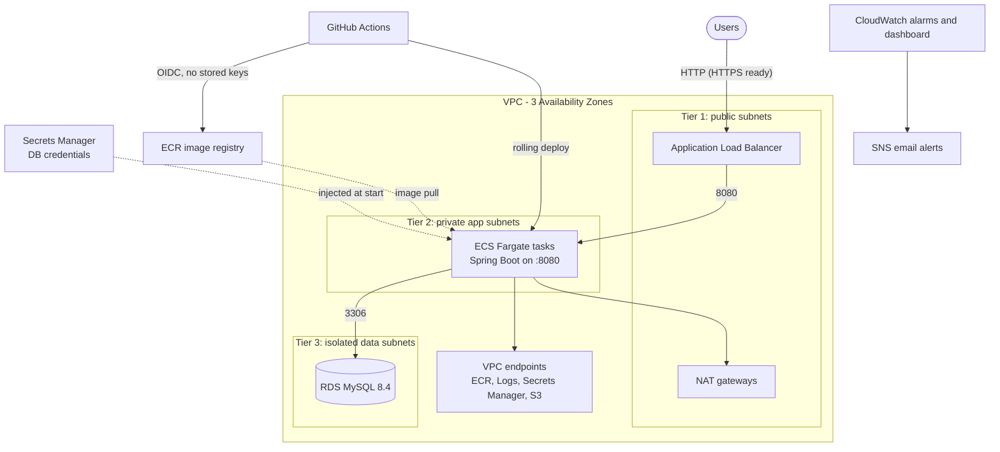

# 3-tier infrastructure on AWS (Terraform, ECS Fargate, MySQL)

Production-style three-tier platform defined entirely as code, with a CI/CD pipeline,
monitoring, and an account security baseline.



| Tier | Component | Network placement |
|---|---|---|
| 1. Presentation | Application Load Balancer | Public subnets |
| 2. Application | ECS Fargate service (autoscaling) | Private app subnets |
| 3. Data | RDS MySQL (Multi-AZ in prod) | Isolated data subnets, no internet route |

## Repository layout

```
app/                    Sample Spring Boot app (notes API) used to prove all three tiers
infra/
  modules/              network, rds, ecr, alb, ecs, monitoring, github-oidc, rotation-restart
  envs/dev/             Cost-trimmed environment
  envs/prod/            Production defaults (+ practice.tfvars for cheap rehearsal)
  account-baseline/     CloudTrail, GuardDuty, budget alert, S3 public-access block
.github/workflows/      build-and-deploy (CI/CD), terraform-ci (fmt + validate)
docs/                   architecture, runbook, acceptance tests, cost, access/ownership
```

## How it works
- **Infrastructure:** Terraform modules, one remote state per environment in S3 with native locking.
- **Deployment:** a push to `main` builds the image, pushes it to ECR tagged with the commit SHA,
  registers a new ECS task definition, rolls it out, and waits for health. A failed rollout
  rolls back automatically (deployment circuit breaker).
- **Credentials:** GitHub authenticates to AWS with OIDC; no AWS keys are stored in GitHub.
- **Secrets:** the database password is generated by RDS into Secrets Manager and injected into
  the container at start. It never appears in code or Terraform state.

## Documentation
- [Architecture and design decisions](docs/architecture.md)
- [Operations runbook](docs/runbook.md)
- [Acceptance tests](docs/acceptance-tests.md)
- [Cost estimate](docs/cost-estimate.md)
- [Access and ownership](docs/access-and-ownership.md)

## Status and known limitations
- HTTP only until a domain and ACM certificate are provided (the ALB module is HTTPS-ready).
- No WAF yet.
- Deploy role trusts the `main` branch; production should add a GitHub Environment with approval.
- The app connects with the RDS master credentials; a least-privilege application user is recommended.
- Database secret rotation is handled by a rotation-restart Lambda; a dedicated, non-rotating application database user is still recommended.
- Single region, no cross-region disaster recovery.
